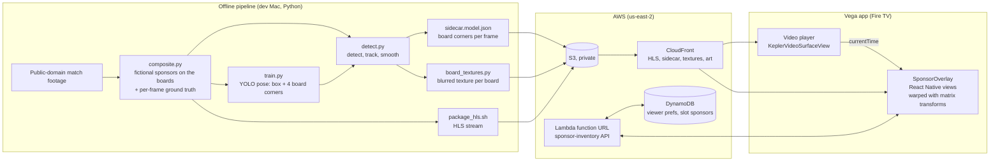

# Cleansheet

**Per-viewer sponsor inventory for Fire TV.** Cleansheet is a Vega OS sports app that finds the sponsor boards in its own video stream and, for each viewer, replaces or blurs the categories they choose to hide (gambling, alcohol). The same board can show a betting brand to one viewer and a family-friendly sponsor to another, so a league can sell each slot twice and viewers get control over what they watch.

Built for the Amazon Developer Hackathon "Build, Ship, Shape": **Fire TV track** (Vega OS) and the **AWS Builder** mini challenge.

- Demo video: _link added at submission_
- Runs on: the Vega Virtual Device (SDK 0.24), streaming from AWS (CloudFront, Lambda, DynamoDB)

## What it does

- **Replaces sponsor boards live.** A fictional replacement sponsor is warped onto each hidden board with a per-board perspective transform. It follows the board as the camera pans and zooms, in sync with the picture to within one video frame.
- **Blurs when unsure.** Boards the detector is less confident about get a blurred texture of the board instead of a replacement, so a shaky detection never shows a swimming logo.
- **Per-viewer settings.** A Sponsors panel in the player (D-pad navigable) sets each category to Show, Auto (replace if confident, else blur), Replace or Blur, applied while the video plays. Choices are saved per profile in the cloud and come back on the next launch.
- **Per-slot sponsor inventory.** Which replacement sponsor fills which board is served by an API, not hard-coded in the app: the inventory a league would sell.

## How it works



- **The device never runs detection.** Fire TV hardware can't run a detector at 30 fps, and it doesn't need to: the cloud publishes a **sidecar track** next to the stream, a timestamped list of where every sponsor board is on every frame ("a caption track for ads"). The app reads the player's `currentTime`, looks up the boards for the frame on screen, and draws replacements as ordinary React Native views over the video. The video itself is never re-encoded, and one stream serves every viewer.
- **Detector.** A YOLO pose model (`yolo11n-pose`) predicts each board's box, brand and 4 corner points, so the app gets a quad it can warp onto directly. `detect.py` adds what a single frame can't give: tracking across frames (camera motion plus each board's own velocity), rebuilding the corners of boards cut off by the frame edge, smoothing, and one brand and confidence per board so it doesn't flicker between treatments.
- **Training data without labelling.** `composite.py` pastes fictional sponsors onto the real boards of public-domain broadcast footage, so every frame comes with exact ground truth. People are segmented and put back in front of the pasted boards. The same clips are re-composited with other brand orders so the model can't learn "this position is BetNova".
- **Sync.** On the Vega Virtual Device, `currentTime` trails the displayed frame by 3 to 4 frames. A fixed 0.117 s offset puts the overlay on the displayed frame in 8 of 12 measured samples and never more than 1 frame off (measured with frame numbers burned into a test stream; see `app/README.md`).
- **Sidecar format.** Each board's brand, category and confidence are stored once; each frame carries only board ids and corners (4 decimals). A 12 s clip is about 1.1 MB of JSON and 231 KB over CloudFront with Brotli. The contract is `shared/sidecar/schema.json`, mirrored in TypeScript and Python.

### Detector accuracy

Measured on `metro_ucv_01`, a held-out clip from a different match, stadium and lighting than any training clip (all 360 frames at 1280x720, against the compositor's ground truth). Run it with `make eval CLIP=metro_ucv_01`.

| | Precision | Recall | Brand accuracy | Corner error (mean / median / p90) |
| --- | --- | --- | --- | --- |
| Raw detector | 0.907 | 1.000 | 0.993 | 5.1 / 4.1 / 9.0 px |
| Tracked sidecar (what the app plays) | **0.979** | **0.999** | **0.994** | 4.8 / 3.9 / 8.5 px |

Every hidden board in the held-out clip is treated (99.9% replaced, the rest blurred). The boards are composited fictional brands, cleaner than real printed boards, so this measures finding and tracking boards in a new stadium more than reading real signage.

## Run it on the Vega Virtual Device

The app streams everything from the project's CloudFront distribution and API, so judging only needs the app; the pipeline below is optional.

Needs the Vega SDK 0.24 (installed at `~/vega`; see developer.amazon.com/apps-and-games), Node 22+, and Java 21+ for the Shaka Player build (Homebrew `openjdk@21`). Tested on macOS (Apple Silicon).

```sh
cd app
export JAVA_HOME=/opt/homebrew/opt/openjdk@21 PATH="$JAVA_HOME/bin:$HOME/vega/bin:$PATH"
npm install                     # also builds Shaka Player into src/w3cmedia/
npm run build:debug             # -> build/aarch64-debug/keplersportapp_aarch64.vpkg
vega virtual-device start -t 300   # the first boot takes longer than the default 60 s
vega device list                # wait until the device shows up
vega run-app build/aarch64-debug/keplersportapp_aarch64.vpkg
```

Then, with the remote (or arrow keys and Enter):

1. Pick a profile, then press **Watch Now** and **Play** on any title. Every title plays the demo clip (`CLIP` in `app/src/cleansheet/config.ts`) on a loop.
2. Gambling and alcohol boards show fictional replacement sponsors.
3. Press any key to bring up the player controls and choose **Sponsors** to set each category to Show, Auto, Replace or Blur. Changes apply immediately and are saved for that profile.

Sign-in is automatic in debug builds when `app/.env` sets `REACT_APP_DEV_AUTO_SIGN_IN_EMAIL` and `REACT_APP_DEV_AUTO_SIGN_IN_PASSWORD` (any values; see `app/.env.example`). More build notes, scripted navigation and the sync test are in `app/README.md`.

## Rebuild the pipeline (optional)

Needs Python 3.10+, Node 20+ and ffmpeg. Training uses PyTorch on Apple Silicon (MPS) and takes about 3.5 hours.

```sh
make setup                        # Python venv + npm install
make test                         # TS unit tests, typecheck, tracker accuracy on the synthetic clip
make synth                        # synthetic stadium clip end to end (no downloads)

footage/tachira.sh                # download the public-domain broadcast (~2 GB) and cut 4 clips
footage/metro_ucv.sh              # the held-out clip from another match
.venv/bin/python -m pip install -r requirements-train.txt   # Ultralytics + PyTorch (person masks, detector)
make clip CLIP=tachira_02         # composite fictional sponsors, package HLS, textures (each clip)
make dataset && make train        # re-composites with other brand orders, then train
make detect CLIP=tachira_02       # model sidecar + board textures
make eval CLIP=metro_ucv_01       # the accuracy table above
make serve                        # local stand-in for CloudFront on :8787 (MEDIA_SOURCE = 'local')
```

Board positions for the real clips are already annotated (`footage/<clip>.boards.json`); `pipeline/annotate.py` adds new clips. `make harness` opens a browser page that plays a clip with its overlays, for testing sync without a device.

### AWS

`cloud/template.yaml` is one CloudFormation stack in `us-east-2`:

- **S3** (private) + **CloudFront** (origin access control, compression, CORS): the HLS streams, sidecar tracks, board textures, sponsor art and catalogue images. `cloud/publish_media.sh` uploads them and invalidates the cache.
- **Lambda** (Python 3.12, arm64, behind a function URL, at most 5 concurrent runs) + **DynamoDB** (on-demand): the sponsor-inventory API. `GET/PUT /viewers/<id>/prefs` holds each profile's hidden categories and treatments; `GET /videos/<id>/inventory` returns the replacement sponsor for every board slot, filled by `cloud/seed_inventory.py` so neighbouring boards get different sponsors.
- **AWS Budgets**: a $5/month alert.

`cloud/deploy.sh` deploys the stack and the API code (it uses the AWS CLI profile `cleansheet`); its header has the teardown commands. Everything here is in the free tier or costs cents at demo scale; inference runs offline, so there are no GPU instances.

## Limitations

- **Players crossing a replaced board are drawn over.** The app paints replacements on top of the video and has no per-frame mask of people, so a player running in front of a hidden board disappears behind the replacement for a moment. (The training composites do keep players in front.)
- **Only its own player.** Cleansheet filters streams it plays itself; it can't touch other apps. It's built as something a league or streaming service would ship.
- **Video on demand only.** Detection runs offline ahead of time. A live version would run the same worker on a GPU and publish the sidecar a few seconds behind the stream.
- **Boards only.** Jersey sponsors are too small to read in a wide shot, and Vega can't blur the video under an overlay, so they aren't treated. A board the detector misses entirely isn't treated either.
- **Prefs aren't private.** The demo has no sign-in: profile ids come from the sample's static auth, and anyone with the API URL can read or change a profile's settings.
- **Fictional sponsors on real boards.** No real brand appears anywhere: the boards in every clip are composited fictional brands, which are easier to detect than real printed signage.

## Next step: real broadcasts

The detector's classes are our fictional brands, and a board's category comes from a brand list, so a gambling brand it has never seen would go unflagged. On real broadcasts we'd split the job in two. A pose model with a single "board" class keeps finding each board's four corners every frame (it can be trained on the real boards already annotated in `footage/`), and a separate step decides what each board is, once per tracked board rather than per frame. The pipeline already straightens every board into a flat image for the blur textures; sending that image to an image-capable classifier (for example TypeSafe's Jev, whose image input is in preview) with the question "gambling, alcohol or neutral?" would return a category with a confidence that feeds **Auto** directly: replace when it's sure, blur when it isn't. Accuracy would then be measured on hand-labelled real footage from several leagues instead of on composites.

## Repository layout

| Path | What it is |
| --- | --- |
| `app/` | The Vega OS app (React Native 0.83), forked from Amazon's `vega-sports-app` sample. Cleansheet's code is in `app/src/cleansheet/`. |
| `shared/sidecar/` | The sidecar track contract: JSON Schema, TypeScript types, frame lookup (`objectsAt`), homography and quad checks. Used by the app and the harness. |
| `pipeline/` | Python: fictional brands, clip cutting, annotation, compositing, detector training and inference, textures, evaluation, HLS packaging. |
| `cloud/` | CloudFormation template, inventory API, deploy, publish and seed scripts, and a local mock CDN. |
| `harness/` | Browser page that plays HLS with overlays, for testing sync. |
| `footage/` | Board annotations, footage download scripts and `LICENSES.md` (video files are git-ignored). |
| `assets/` | Generated fictional sponsor art (`brands/`) and the app's catalogue images (`ui/`). |
| `FRICTION_LOG.md` | Every Vega SDK, Builder Tools MCP and AWS issue hit while building. |
| `PRODUCT_FEEDBACK.md` | Product feedback on every tool and AWS service used, with feature requests. |

## Footage and brands

All footage is public domain: Venezolana de Televisión broadcasts of two Liga FUTVE matches, published on Wikimedia Commons under {{PD-VenezuelaGov}}. Sources, timestamps and processing for every clip are in `footage/LICENSES.md`. Scorebugs and channel logos are pixelated, and the original sponsor boards are covered by fictional brands before anything is shown. Every brand in this repository and the demo ("BetNova", "Quillo Juice", ...) is made up.

## License

- `pipeline/` is AGPL-3.0 (`pipeline/LICENSE`): the detector training, inference and person masking use [Ultralytics YOLO](https://github.com/ultralytics/ultralytics), which is AGPL-3.0, and so would any weights trained with it.
- Everything else (the Vega app, `shared/`, `cloud/`, `harness/`, assets) is MIT (`LICENSE`). None of it imports Ultralytics. `app/` is forked from Amazon's `vega-sports-app` (MIT-0, `app/LICENSE`).
